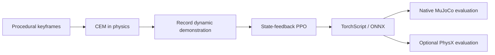

# GPT-IAYN

**GPT Is All You Need** — a GPT-built robotics experiment, from generated motion data to a feedback policy.

[中文说明](README.zh-CN.md) · [Data generation](docs/DATA_GENERATION.md) · [Training](docs/TRAINING.md) · [Results](docs/RESULTS.md) · [GPT's contribution](docs/GPT_WORK.md) · [Release verification](docs/RELEASE_VERIFICATION.md)

This project teaches a simulated **Unitree G1 to perform a standing, two-foot backward jump over a 0.8 m bar**. Under human direction, GPT developed the scene, synthetic motion seed, trajectory search, PPO feedback controller, evaluation tools and experiment documentation. The release includes the data-generation process, generated references, frozen CEM controller, trained PPO weights and recorded evidence.

The name is a project title, not a claim that GPT runs the robot or replaces the research foundations. At runtime a small neural policy outputs **29 joint-position targets at 50 Hz**, followed by joint PD control with a DC torque-speed envelope at 400 Hz. MuJoCo integrates the free-floating robot. No GPT API, humanoid motion dataset or competition footage is required.

<video src="media/g1-ppo-mujoco-online.mp4" controls width="720"></video>

[Native MuJoCo online video](media/g1-ppo-mujoco-online.mp4) · [Recorded PhysX online video](media/g1-ppo-physx-online.mp4)

## What is included



- Synthetic motion generation with documented keyframes and interpolation.
- CEM search and a frozen accepted controller, including its initialization candidate.
- Physical demonstration recording: states are produced by actuators and physics.
- Reference-conditioned differential-feedback PPO, observations, rewards and training settings.
- Frozen deployment models, relative-path contracts, checksums and independent evaluations.
- Historical failure modes and measured limitations, including weak perturbation robustness.

## Quick start: run the frozen PPO policy

Python **3.11** is the tested interpreter. The native path needs no mjlab, Isaac Sim or training GPU. Video rendering needs an available OpenGL backend; on headless Linux use EGL.

```bash
git clone https://github.com/czc000/GPT-IAYN.git
cd GPT-IAYN
python3.11 -m venv .venv
source .venv/bin/activate
python -m pip install -r requirements/eval.txt
python -m pip install --no-deps -e .
python gpt_iayn.py restore
python gpt_iayn.py demo
MUJOCO_GL=egl python gpt_iayn.py demo --video --output artifacts/demo-video
```

`restore` verifies the bundled data, copies it into the ignored `artifacts/` workspace, and obtains hash-matched G1 meshes from the pinned mjlab 1.2.0 package. It uses an existing matching installation when available; otherwise it downloads the wheel without installing the training framework. Changed experiment files are never overwritten.

Output: `artifacts/demo-video/seed0.mp4`, `metrics.json` and `seed0.npz`. This video is rendered in the same loop as policy inference and `mj_step`; it is not a qpos playback.

## Reproduce the data and train

Use a separate training environment; [installation details and the historical dependency exception](docs/INSTALL.md) are explicit.

```bash
bash tools/setup_training.sh .venv-train
source .venv-train/bin/activate
python gpt_iayn.py restore
python gpt_iayn.py seed
python gpt_iayn.py teacher
HIGHJUMP_GPU=0 ./scripts/runtime.sh gpt_iayn.py train --name ppo --iterations 500
python scripts/export_policy.py --run artifacts/ppo --checkpoint model_499 \
  --gain 0.5 --output artifacts/ppo-export
python scripts/evaluate_rl.py --run artifacts/ppo-export \
  --policy artifacts/ppo-export/policy.torchscript --output artifacts/ppo-eval --video
```

The short path reconstructs the teacher from the bundled CEM controller. To optimize a new controller, use `gpt_iayn.py search` and follow the independent acceptance/promotion procedure in [Data generation](docs/DATA_GENERATION.md). `search --from-zero` exposes the full procedural starting point, but does **not** promise to rediscover the historical solution in a fixed budget. GPU training is stochastic; packaging verification is not a second 500-update retraining result.

## What the results support

| Setting | Recorded result |
|---|---|
| Final PPO, native MuJoCo nominal | Accepted nominal online rollout |
| Final gain 0.5, small initial perturbations | 19/50 accepted; corresponding fixed-target baseline 13/50 |
| Final gain 0.5, larger initial perturbations | 3/50 accepted; corresponding fixed-target baseline 4/50 |
| PhysX | One calibrated nominal pass; minimum bar gap about 1.9 mm |
| Real G1 | Not tested |

MuJoCo-Warp → native MuJoCo is a **backend transfer**. The recorded PhysX result is a separate cross-engine test after feedback-gain calibration, not zero-shot transfer or proven cross-engine robustness. The earlier CEM controller's 19/20 statistic is a different experiment and is not the PPO success rate. See [results and limitations](docs/RESULTS.md).

## Repository layout

```text
gpt_iayn.py             # One root CLI: restore / demo / seed / teacher / search / train
src/gpt_iayn_core/       # Importable scene, actuator, policy, observation and evaluation code
scripts/                # Supported data generation, training, export and evaluation commands
  isaac/                # Optional Isaac Sim / PhysX conversion and execution
tools/                  # Training setup and independent validation utilities
experiments/legacy/     # Earlier searches, diagnostic runs and old fixture-dependent tests
tests/                  # Current regression suite
docs/                   # Methods, results, verification and historical reports
release-data/           # Immutable references, trained models, contracts and evidence
media/                  # Recorded simulation videos
```

Start with `python gpt_iayn.py --help`. After editable installation, `gpt-iayn` is an equivalent command. See the [script index](scripts/README.md), [validation index](tools/validation/README.md) and [legacy index](experiments/legacy/README.md). Shared runtime code never imports a validation or legacy script.

For example, export with `python scripts/export_policy.py ...`, evaluate with `python scripts/evaluate_rl.py ...`, and select a GPU with `HIGHJUMP_GPU=0 ./scripts/runtime.sh gpt_iayn.py train ...`. The root CLI commands are unchanged; old direct root-script paths moved in v0.1.1. A complete [migration map](docs/LAYOUT.md) lists the new paths.

Run current tests after restoring data, in the training environment:

```bash
python -m unittest discover -s tests -v
```

Historical auxiliary scripts remain for traceability. They may require absent historical fixtures and are not part of the supported quick-start workflow.

## Attribution and license

Project-specific contributions are released under [MIT](LICENSE). mjlab, MuJoCo, MuJoCo-Warp, RSL-RL, BeyondMimic, Unitree G1 assets, PyTorch and optional Isaac Sim are credited in [THIRD_PARTY_NOTICES.md](THIRD_PARTY_NOTICES.md). GPT generated project-specific work under user direction; it did not invent or author those foundations. See [GPT_WORK.md](docs/GPT_WORK.md).
